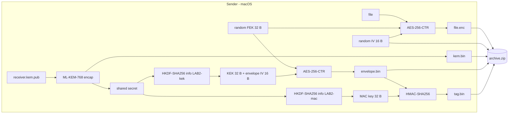

# Post-Quantum File Sharing with ML-KEM

ML-KEM is a modern cryptographic algorithm designed to protect encryption keys against attacks from both traditional computers and future quantum computers.

We will encrypt a file on one machine so that only one specific receiver can open it, using **ML-KEM-768** (FIPS 203), the post-quantum key-encapsulation standard. Built entirely from OpenSSL command-line tools and bash.

The example setup is two machines:

| Role | Machine | Holds |
|---|---|---|
| Sender | macOS | the receiver's **public** key |
| Receiver | Linux VM | its own **private** key |

## How it works

ML-KEM cannot encrypt a file, or even a key. Encapsulation takes only a public key and returns two things: a fresh **shared secret** and a **KEM ciphertext** that lets the receiver recompute that secret. So the file is encrypted with an ordinary AES key, and that key travels inside a small envelope locked with a key derived from the shared secret.



The receiver reverses this: it decapsulates `kem.bin` with its private key, runs the same two HKDF calls, recomputes the HMAC tag, and only if the tag matches does it unwrap the file key and decrypt the file.

### Algorithms

| Element | Choice |
|---|---|
| Key establishment | ML-KEM-768 |
| Key derivation | HKDF-SHA256, no salt. Info `LAB2-kek` gives 48 bytes (first 32 = KEK, last 16 = envelope IV). Info `LAB2-mac` gives 32 bytes (MAC key). |
| File cipher | AES-256-CTR, random 32-byte key, random 16-byte IV |
| Envelope cipher | AES-256-CTR under the KEK |
| Envelope integrity | HMAC-SHA256 over the envelope ciphertext |

### Archive contents

| File | Size | Secret? |
|---|---|---|
| `file.enc` | same as the original | no |
| `iv.hex` | 16 bytes as 32 hex characters | no |
| `kem.bin` | 1088 bytes | no |
| `envelope.bin` | 32 bytes | no |
| `tag.bin` | 32 bytes | no |

The file key, shared secret, KEK, envelope IV and MAC key are destroyed by the sender before the script exits.

## Prerequisites
 
Everything below must be in place before you run any script.
 
### Both machines
 
| Requirement | Why it is needed | How to check |
|---|---|---|
| **OpenSSL 3.5 or newer** | ML-KEM-768, HKDF and HMAC are built into the default provider from 3.5 | `openssl version` and `openssl list -kem-algorithms \| grep -i ml-kem` |
| **Bash** | all scripts are bash scripts (macOS's built-in bash 3.2 works) | `bash --version` |
| **xxd** | converts binary keys to hex for OpenSSL | `xxd -v` |
| **zip** and **unzip** | build and open the archive | `zip -v`, `unzip -v` |
| **Standard Unix tools** | `head`, `tail`, `cmp`, `wc`, `mktemp`, `find` (preinstalled on macOS and Ubuntu) | |
| **git** (optional) | to clone this repository | `git --version` |
 

### macOS (sender)

macOS ships LibreSSL, which has no ML-KEM. Install OpenSSL with Homebrew and put it first on your `PATH`:

```bash
brew install openssl@3
```

### Linux VM (receiver)

```bash
sudo apt install -y zip unzip xxd openssh-server
```

## Security notes and limitations

- **The file itself is not authenticated.** The HMAC covers only the 32-byte envelope. If someone changes `file.enc`, the tag still matches and the receiver writes corrupted data without complaint, because CTR mode has no integrity. Fixing this needs a signature over the whole archive, for example ML-DSA (FIPS 204).
- **The HMAC does not prove who sent the archive.** Sender and receiver can both compute the MAC key, so either could have made the tag.
- **Keys appear briefly in process arguments.** OpenSSL's `enc -K`, `kdf hexkey:` and `-macopt hexkey:` accept keys only as arguments. The scripts read keys from files at call time, so keys never enter shell history, but they are visible in `ps` while each command runs.
- **Secure deletion is best effort.** The scripts use `shred -u` on Linux and `rm -P` on macOS. On SSDs and copy-on-write file systems, overwriting is not guaranteed to reach the physical blocks.

## Project structure

```
.
├── README.md
├── images/
    ├── basic-MLKEM-flow.png           
    ├── decrypted-file.png           
    ├── tag-match.png           
    └── unzip-archive.png       
└── scripts/
    ├── receiver_side.sh           
    └── sender_side.sh.sh   
```

## References

- [FIPS 203: ML-KEM](https://csrc.nist.gov/pubs/fips/203/final)
- [RFC 5869: HKDF](https://www.rfc-editor.org/rfc/rfc5869)
- `man openssl-pkeyutl`, `man openssl-kdf`, `man openssl-enc`