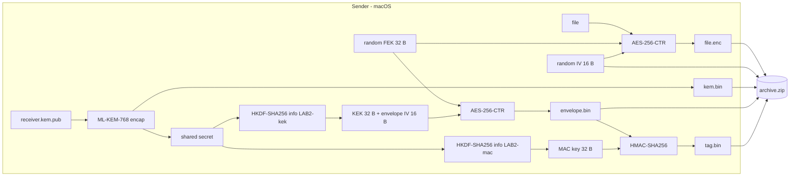

````markdown
# Post-Quantum File Sharing with ML-KEM

Encrypt a file on one machine so that only one specific receiver can open it, using **ML-KEM-768** (FIPS 203), the post-quantum key-encapsulation standard. Built entirely from OpenSSL command-line tools and bash.

The example setup is two machines:

| Role | Machine | Holds |
|---|---|---|
| Sender | macOS | the receiver's **public** key |
| Receiver | Linux VM | its own **private** key |

## How it works

ML-KEM cannot encrypt a file, or even a key. Encapsulation takes only a public key and returns two things: a fresh **shared secret** and a **KEM ciphertext** that lets the receiver recompute that secret. So the file is encrypted with an ordinary AES key, and that key travels inside a small envelope locked with a key derived from the shared secret.



The receiver reverses this: it decapsulates `kem.bin` with its private key, runs the same two HKDF calls, recomputes the HMAC tag, and only if the tag matches does it unwrap the file key and decrypt the file.

### Algorithms

| Element | Choice |
|---|---|
| Key establishment | ML-KEM-768 |
| Key derivation | HKDF-SHA256, no salt. Info `LAB2-kek` gives 48 bytes (first 32 = KEK, last 16 = envelope IV). Info `LAB2-mac` gives 32 bytes (MAC key). |
| File cipher | AES-256-CTR, random 32-byte key, random 16-byte IV |
| Envelope cipher | AES-256-CTR under the KEK |
| Envelope integrity | HMAC-SHA256 over the envelope ciphertext |

### Archive contents

| File | Size | Secret? |
|---|---|---|
| `file.enc` | same as the original | no |
| `iv.hex` | 16 bytes as 32 hex characters | no |
| `kem.bin` | 1088 bytes | no |
| `envelope.bin` | 32 bytes | no |
| `tag.bin` | 32 bytes | no |

The file key, shared secret, KEK, envelope IV and MAC key are destroyed by the sender before the script exits.

## Requirements

- **OpenSSL 3.5 or newer** (ML-KEM is built in from 3.5).
- `xxd`, `zip`, `unzip`.
- Bash. The scripts run on macOS's built-in bash 3.2 and on Linux.

### macOS (sender)

macOS ships LibreSSL, which has no ML-KEM. Install OpenSSL with Homebrew and put it first on your `PATH`:

```bash
brew install openssl@3
echo 'export PATH="$(brew --prefix openssl@3)/bin:$PATH"' >> ~/.zshrc
source ~/.zshrc
```

### Linux VM (receiver)

```bash
sudo apt install -y zip unzip xxd openssh-server
```

Ubuntu 26.04 ships OpenSSL 3.5. On 22.04 or 24.04, build OpenSSL 3.5 into `/opt` and put it first on your `PATH`; do not replace the system OpenSSL.

### Check both machines

```bash
./scripts/check_env.sh
```

## Usage

Replace `VMUSER` and `VMIP` with the VM's username and IP address (`whoami` and `hostname -I` on the VM).

**1. Receiver (VM): create a key pair.**

```bash
./scripts/keygen.sh receiver
```

**2. Sender (Mac): fetch the receiver's public key.**

```bash
scp VMUSER@VMIP:~/mlkem-file-sharing/receiver.kem.pub .
```

**3. Sender (Mac): encrypt.**

```bash
./scripts/sender_encrypt.sh receiver.kem.pub myfile.pdf archive.zip
```

The script prints the SHA-256 of the original so you can compare it later.

**4. Sender (Mac): send the archive.**

```bash
scp archive.zip VMUSER@VMIP:~/mlkem-file-sharing/
```

**5. Receiver (VM): decrypt.**

```bash
./scripts/receiver_decrypt.sh receiver.kem.priv archive.zip myfile.pdf
```

If the printed SHA-256 matches the sender's, the file arrived byte for byte.

### See implicit rejection

```bash
./scripts/demo_implicit_rejection.sh
```

This decapsulates one ciphertext with the right key and with a wrong key. The wrong key gets a different, normal-looking secret and exit code 0. ML-KEM never reports failure, because a visible failure would leak information about the private key. That is why the receiver trusts the envelope only after its HMAC tag matches.

## Security notes and limitations

- **The file itself is not authenticated.** The HMAC covers only the 32-byte envelope. If someone changes `file.enc`, the tag still matches and the receiver writes corrupted data without complaint, because CTR mode has no integrity. Fixing this needs a signature over the whole archive, for example ML-DSA (FIPS 204).
- **The HMAC does not prove who sent the archive.** Sender and receiver can both compute the MAC key, so either could have made the tag.
- **Keys appear briefly in process arguments.** OpenSSL's `enc -K`, `kdf hexkey:` and `-macopt hexkey:` accept keys only as arguments. The scripts read keys from files at call time, so keys never enter shell history, but they are visible in `ps` while each command runs.
- **Secure deletion is best effort.** The scripts use `shred -u` on Linux and `rm -P` on macOS. On SSDs and copy-on-write file systems, overwriting is not guaranteed to reach the physical blocks.
- Private keys are excluded by `.gitignore`. Never commit them.

## Project structure

```
.
├── README.md
├── .gitignore
└── scripts/
    ├── common.sh                   shared helpers (HKDF, HMAC, cleanup)
    ├── check_env.sh                checks OpenSSL and tools
    ├── keygen.sh                   receiver: create ML-KEM-768 key pair
    ├── sender_encrypt.sh           sender: build the archive
    ├── receiver_decrypt.sh         receiver: verify tag and decrypt
    └── demo_implicit_rejection.sh  shows wrong-key decapsulation
```

## References

- [FIPS 203: ML-KEM](https://csrc.nist.gov/pubs/fips/203/final)
- [RFC 5869: HKDF](https://www.rfc-editor.org/rfc/rfc5869)
- `man openssl-pkeyutl`, `man openssl-kdf`, `man openssl-enc`
````